<p align="center">
  
</p>

<h1 align="center">TuneNook</h1>

<p align="center">A cozy focus nook in your macOS menu bar: a task-driven focus timer with built-in radio.</p>

<p align="center"><em>Tune in. Get it done.</em></p>

## Features

- **Menu bar timer**: time left shows in the menu bar. Start, pause, resume, stop and skip from a popover. Press Space to start or pause.
- **Topics & tasks**: group to-dos by topic, estimate focus sessions per task and track actual against estimate.
- **Focus cycle**: focus, short break and a long break every N sessions (Pomodoro-style by default), all configurable. Breaks can start automatically.
- **Focus Radio**: one-click internet radio from [SomaFM](https://somafm.com).
- **Notifications** when a phase ends. They are scheduled ahead of time, so they fire even when the app is idle.
- **Daily goal & streaks** (v0.2): set a daily target in focus minutes or sessions. Meeting it grows your streak, and every 7-day streak earns a freeze (max 2) that covers a missed day. You can set when a new day starts, for night owls.
- **Progress page** (v0.2): today's ring, current and best streak, freezes, last 7 days, a GitHub-style heatmap of focus history and deadline pacing per topic (sessions per day needed).
- **Celebrations** (v0.3): confetti when you reach your daily goal, hit a streak milestone (3, 7, 14, 30… days) or unlock an icon. Set it to off, milestones only or every session. It respects Reduce Motion.
- **Unlockable menu bar icons** (v0.3): 10 icons earned by sessions finished, best streak and goal days. Pick one in Settings → Rewards or on the Progress page.
- **Smart music rules** (v0.3): on a break, keep playing, lower the volume, stop or switch to a break station. Pausing the timer pauses the music and resuming continues it; stopping the timer stops it. Music never starts by itself; you press play.
- **Open at login**: one switch in Settings → General, using the system login items.
- **Global shortcut**: start or pause from any app, ⌃⌥P by default. You can record another shortcut in Settings or turn it off. It needs no Accessibility permission.
- **Auto-pause when away**: focus pauses when the Mac locks or sleeps, and optionally after 2–15 idle minutes. Idle time isn't counted, and a notification with **Resume Focus** greets you when you're back.
- **Media keys & Now Playing**: ⏯ on the keyboard or AirPods plays and pauses the radio, ⏭/⏮ change station, and the station shows in Control Center.
- **Sleep-proof**: remaining time comes from an end date, so the timer catches up correctly after sleep.

## Roadmap

| Phase | Scope |
|---|---|
| **MVP** ✅ | Menu bar timer, topic/task CRUD, estimate vs actual, notifications, radio |
| **v0.2** ✅ | Daily targets, streaks with freezes, GitHub-style heatmap, deadline pacing |
| **v0.3** ✅ | Celebration animations, unlockable menu bar icons, smart music rules (pause or switch on breaks) |
| Later | Stats & estimate accuracy, macOS Focus Filters, iCloud sync, remote station list |

## Development

Requirements: a Mac with Apple silicon (Intel is not supported), macOS 14+, Xcode 16+, [XcodeGen](https://github.com/yonaskolb/XcodeGen) (`brew install xcodegen`).

```sh
xcodegen generate           # creates TuneNook.xcodeproj from project.yml
open TuneNook.xcodeproj
```

From the command line:

```sh
xcodebuild -scheme TuneNook -destination 'platform=macOS' -derivedDataPath build build
xcodebuild -scheme TuneNook -destination 'platform=macOS' -derivedDataPath build test
open build/Build/Products/Debug/TuneNook.app
```

The Xcode project, `Info.plist` and entitlements are generated, so edit `project.yml` instead.

The app icon comes from `design/app-icon.svg`. After editing it, run `swift scripts/render-app-icon.swift` to regenerate the PNGs in `AppIcon.appiconset`.

## Workflow & CI

`main` only changes through pull requests. After cloning, turn on the repo's git hooks once:

```sh
git config core.hooksPath .githooks   # pre-push hook blocks direct pushes to main
```

Work on a branch, push it and open a pull request into `main`. PRs merge with a merge commit (squash and rebase merges are off).

[CI](.github/workflows/ci.yml) runs on every pull request into `main` and again after the merge:

1. **Security scan** (Linux): [Gitleaks](https://github.com/gitleaks/gitleaks) checks the whole git history for secrets, and [Semgrep](https://semgrep.dev) checks the code with the Swift, secrets and GitHub Actions rule packs.
2. **Test** (macOS, runs only if the scan passes): generates the project with XcodeGen and runs the test suite.

### Versioning

PR titles follow [Conventional Commits](https://www.conventionalcommits.org), and a check fails the PR if the title doesn't match. When a PR is merged into `main` and CI passes, the [Release workflow](.github/workflows/release.yml) bumps the version in `project.yml` and tags the commit. It looks at every PR merged since the last release, including all PRs of a merged stack, and applies the biggest bump among their titles. For example, a stack with a `fix:` and a `feat:` gets a minor bump. Only a version bump builds the app. The Release build is published as a GitHub Release in two forms: a `.dmg` (open it and drag TuneNook to Applications) and a `.zip`. The release also has a `.sha256` file with checksums for both, and notes generated from the merged PRs. Try the disk image locally with `scripts/make-dmg.sh build/Build/Products/Debug/TuneNook.app TuneNook.dmg`.

The app is ad-hoc signed and not notarized. The first time you open a downloaded build, right-click the app and choose **Open**, or run `xattr -dr com.apple.quarantine TuneNook.app`. This applies to the `.dmg` as well.

| PR title | Bump | Example |
|---|---|---|
| `feat: …` | minor | 0.3.0 → 0.4.0 |
| `fix: …`, `perf: …` | patch | 0.3.0 → 0.3.1 |
| `feat!: …`, `fix!: …` (any type with `!`) | major | 0.3.0 → 1.0.0 |
| `docs`, `chore`, `ci`, `test`, `refactor`, `build`, `style`, `revert` | none | |

A scope is optional: `fix(radio): reconnect after sleep`. The build number (`CURRENT_PROJECT_VERSION`) goes up by one with every release. Try a title locally with `scripts/release.sh level "feat: weekly stats"`.

Changes that only touch Markdown skip CI. The repo is private on GitHub Free, so GitHub can't enforce branch rules on the server. The hook is the guard, and `git push --no-verify` gets past it.

## Structure

```
TuneNook/
  App/            App entry, scenes, SessionCoordinator (timer events → data, rewards, music)
  Models/         SwiftData models: Topic, TodoTask, FocusSession
  Timer/          TimerEngine (state machine) and TimerSettings
  Progress/       Daily goals, focus-day calendar, streak & heatmap stats
  Rewards/        Icon unlocks, celebration rules and the overlay
  Audio/          RadioPlayer (AVPlayer), stations and music rules
  System/         Launch at login, global shortcut, away detection
  Notifications/  Phase-end, goal and away notifications
  Views/          Menu bar popover, main window, progress page, settings
  Resources/      stations.json, Assets.xcassets (app icon)
TuneNookTests/    Timer, streak, reward and music rule tests (Swift Testing)
design/           App icon source (SVG)
scripts/          Release versioning, disk image packaging, app icon rendering
```

Streaks and the heatmap are derived from `FocusSession` rows, so there is a single source of truth. Goal changes are stored as a history, so raising the goal today never rewrites past days.
